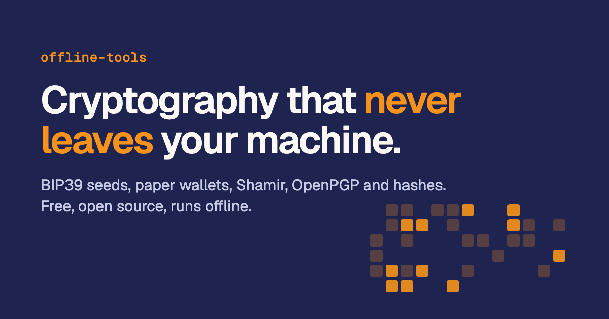

<div align="center">



# Offline Tools

**Crypto and Bitcoin tools that run entirely in your browser, built for computers with no network.**

Generate and check BIP39 seed phrases, print BIP38 paper wallets, split secrets with Shamir, encrypt with OpenPGP, hash files and move data across an air gap with QR codes. No backend, no network calls, no telemetry.

[](https://github.com/cicerotcv/offline-tools/actions/workflows/ci.yml)
[](https://github.com/cicerotcv/offline-tools/releases)
[](./LICENSE)
[](#security-model)
[](#security-model)
<br />
[](https://www.typescriptlang.org/)
[](https://react.dev/)
[](https://vite.dev/)
[](https://buymeabitcoffee.vercel.app/btc/bc1qzjgnlpgg046yemulzxluvcqnd26p52k968n2as?identifier=Offline+Tools&lightning=modularactress47%40walletofsatoshi.com)

[**Open the app**](https://offline-tools-taupe.vercel.app) · [**Download a release**](https://github.com/cicerotcv/offline-tools/releases) · [How to verify](#download-and-verify) · [Report a vulnerability](./SECURITY.md)

</div>

---

## Tools

| Tool                                                                                  | What it does                                                                                                                                            |
| ------------------------------------------------------------------------------------- | ------------------------------------------------------------------------------------------------------------------------------------------------------- |
| [Seed Generation](https://offline-tools-taupe.vercel.app/tools/seed-generation)       | BIP39 phrases of 12 to 24 words from the browser CSPRNG or your own entropy (dice, text, files, mouse, camera), with a backup check before you use them |
| [Seed Validation](https://offline-tools-taupe.vercel.app/tools/seed-validation)       | Checks a phrase as you type: unknown words, length and checksum                                                                                         |
| [Wallet Recovery](https://offline-tools-taupe.vercel.app/tools/wallet-recovery)       | Addresses and keys from a phrase, a master seed or an xpub/xprv, with BIP44, BIP49 and BIP84                                                            |
| [Paper Wallet](https://offline-tools-taupe.vercel.app/tools/paper-wallet)             | A printable single-address wallet with a BIP38-encrypted key, checked against the address                                                               |
| [Tiny Seed](https://offline-tools-taupe.vercel.app/tools/tiny-seed)                   | BIP39 words to the 11-bit grid of punched metal backups, and back                                                                                       |
| [Shamir's Secret Sharing](https://offline-tools-taupe.vercel.app/tools/shamir)        | Splits a secret into N shares, any M of which recover it; printable cards and laser-engraving SVG plates                                                |
| [Encryption](https://offline-tools-taupe.vercel.app/tools/encryption)                 | OpenPGP password encryption for text and files, readable by GnuPG                                                                                       |
| [Hash](https://offline-tools-taupe.vercel.app/tools/hash)                             | SHA-256, SHA-512 and MD5 of text, files or camera captures, and checksum verification                                                                   |
| [Password Generator](https://offline-tools-taupe.vercel.app/tools/password-generator) | Random passwords from the CSPRNG, optionally mixed with mouse movement                                                                                  |
| [QR Code](https://offline-tools-taupe.vercel.app/tools/qr-code)                       | Generate and scan QR codes to carry addresses or checksums across an air gap                                                                            |

## Security model

The main risk of a tool like this is not a remote attack, since there is no server, but **wrong cryptographic output without a warning**, or **a secret leaking locally**. The design targets both.

- **Nothing leaves the page.** The build ships a Content-Security-Policy with `connect-src 'self'`, so the browser itself blocks any request to a third party. An end-to-end test proves it.
- **Checked against official vectors.** BIP39, BIP32, BIP38, BIP49, BIP84, SHA-2, AES-GCM and GF(256) are tested against their official test vectors, plus property tests with fast-check.
- **Self-test before every tool opens.** A known-answer test runs in your browser first; if it fails, the tool stays disabled instead of producing wrong keys.
- **Verify after generate.** Mnemonics are checksummed, paper wallets re-derive the address from the printed key, and Shamir splits are reopened with M shares (and not with M-1) before anything is shown.
- **Authenticated Shamir shares.** Shares use AES-256-GCM with the header as authenticated data and a per-share checksum, so too few, damaged or altered shares can never produce a wrong secret.
- **Secrets stay in memory.** Nothing is stored (only the theme), fields avoid autofill and spellcheck, copied secrets are cleared from the clipboard, and secrets are discarded when you leave a tool.

## Download and verify

For real seeds and keys, use the single-file release on a computer with no network connection (Tails works). Each [release](https://github.com/cicerotcv/offline-tools/releases) has:

| File                            | Use                                        |
| ------------------------------- | ------------------------------------------ |
| `offline-tools-vX.Y.Z.html`     | The whole app in one file, for a USB stick |
| `offline-tools-vX.Y.Z-site.zip` | The hosted build, to serve yourself        |
| `SHA256SUMS`                    | The SHA-256 of both                        |

Before using a file, on a trusted machine:

```bash
shasum -a 256 -c SHA256SUMS                                        # 1. checksums
gh attestation verify offline-tools-vX.Y.Z.html --repo cicerotcv/offline-tools   # 2. provenance
```

1. The checksums must match (or compare the hash with the app's own Hash Tool).
2. GitHub's signed attestation proves the file was built by this repository's release workflow from that tag.
3. Optional: the build is reproducible. Check out the tag and run `scripts/build-release.sh out`; you get the same hashes.

Then copy the HTML file to the offline computer and open it. Routing switches to hash mode on `file://`, and the footer shows the version.

## Development

Requires Node 24 and pnpm (the version is pinned in `package.json`).

```bash
git clone https://github.com/cicerotcv/offline-tools.git
cd offline-tools
pnpm install
pnpm dev
```

| Command                | What it does                                                            |
| ---------------------- | ----------------------------------------------------------------------- |
| `pnpm dev`             | Development server                                                      |
| `pnpm build`           | Type-check, hosted build with CSP and static per-route pages in `dist/` |
| `pnpm build:single`    | The self-contained single HTML file                                     |
| `pnpm lint`            | ESLint, architecture boundaries included                                |
| `pnpm test:run`        | Unit, property and official-vector tests                                |
| `pnpm test:coverage`   | The same, with coverage                                                 |
| `pnpm test:e2e`        | Every route in the hosted build                                         |
| `pnpm test:e2e:single` | Every route in the single-file build, on `file://`                      |
| `pnpm test:e2e:static` | Static pages, 404s, redirects and headers, as hosted                    |

Stack: React 19, TypeScript (strict), Vite 7, TanStack Router, Tailwind CSS v4 and shadcn/ui; cryptography from Web Crypto, OpenPGP.js, bitcoinjs-lib and noble-hashes. The architecture (layered modules, crypto behind ports, self-tests) is described in [AGENTS.md](./AGENTS.md).

## Contributing

Contributions are welcome. Every change must keep the promise of the project: everything runs client-side, nothing reaches the network, and every cryptographic primitive is tested against official vectors. Open a pull request against `main`; CI runs lint, type-check, the test suites and the end-to-end tests of both builds.

## Security

Found wrong output or a way to leak a secret? Report it privately through a [GitHub security advisory](https://github.com/cicerotcv/offline-tools/security/advisories/new). See [SECURITY.md](./SECURITY.md).

## Support

Offline Tools is free and has no ads or tracking. If it helps you keep your keys safe, you can buy me a coffee in bitcoin:

<div align="center">

[](https://buymeabitcoffee.vercel.app/btc/bc1qzjgnlpgg046yemulzxluvcqnd26p52k968n2as?identifier=Offline+Tools&lightning=modularactress47%40walletofsatoshi.com)

**On-chain:** `bc1qzjgnlpgg046yemulzxluvcqnd26p52k968n2as`
<br />
**Lightning:** `modularactress47@walletofsatoshi.com`

</div>

## License

[MIT](./LICENSE) © [cicerotcv](https://github.com/cicerotcv)
